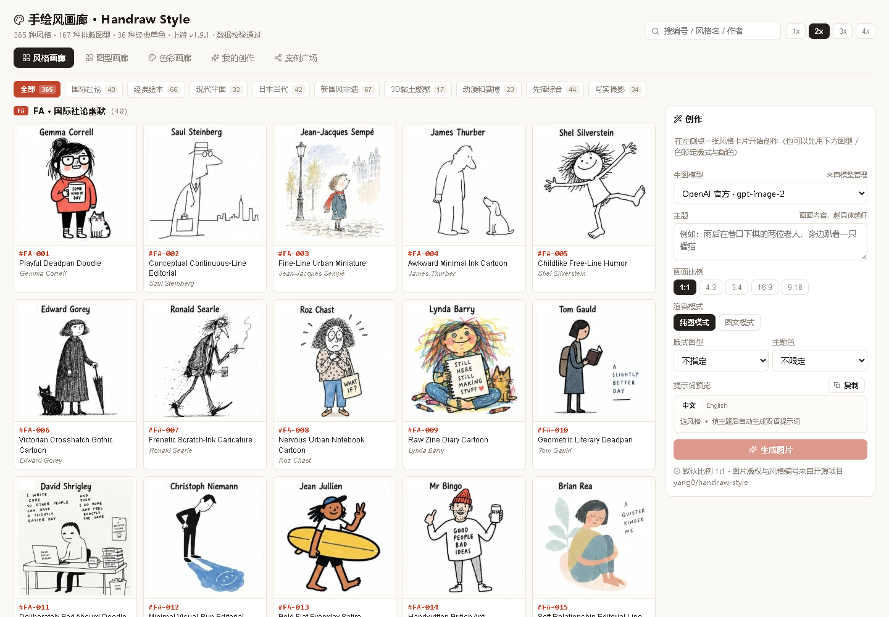
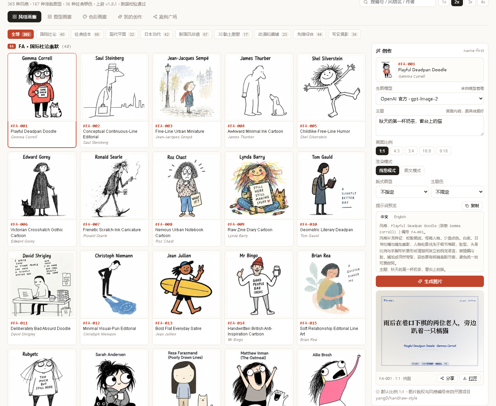
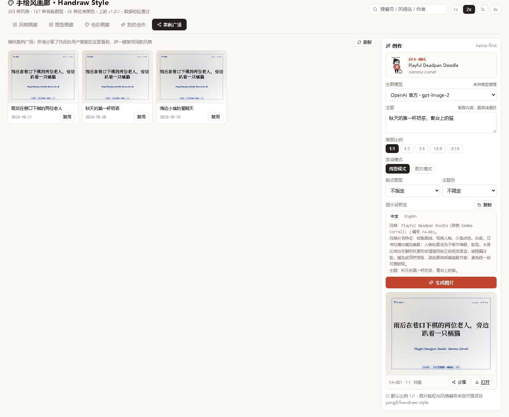

# 手绘风画廊（Handraw Style）· 若道插件

> 英文文档：[README.en.md](./README.en.md)

> 项目来自于 [yang0/handraw-style](https://github.com/yang0/handraw-style) · 当前同步上游 **v1.9.2**

把开源项目 [yang0/handraw-style](https://github.com/yang0/handraw-style)（366 种手绘风格 + 167 种排版图型 + 36 种经典单色）做成若道桌面端里**能看图、能直接出图、能分享案例**的插件工作台。

## 它解决什么

原版 skill 的工作方式是：报编号 → 拿到一段提示词 → 自己复制去 Midjourney / SD 出图。插件把中间的「选」和「出」都搬进工作台：

| | 原版 skill | 本插件 |
|---|---|---|
| 选风格 | 记编号、翻 Markdown 图鉴 | 366 张缩略图按 FA–FI 九大类铺开，点卡片看编号/作者/特征词 |
| 出图 | 复制提示词去第三方工具 | 右侧面板选模型（复用「模型管理」里已配好的图片模型）直接生成 |
| 沉淀 | 提示词散在聊天记录里 | 我的创作保留最近 40 条，成图可一键分享到插件案例 |

## 界面



- **风格画廊**：分组筛选（带数量）、1x–4x 尺寸切换、搜索编号/风格名/作者，点击卡片选中
- **图型画廊**：社媒卡 23 / 信息图 36 / 漫画分镜 71 / IP 设计 13 / 电商 24，点一下即带入创作
- **色彩画廊**：36 款经典单色，六大色系，点一下锁定画面基调
- **我的创作**：本机生成记录，可分享、可打开原图
- **案例广场**：所有分享过作品的用户，点「复用」自动带回同款风格与主题





## 三件事分别落在哪

| 能力 | 实现位置 |
|---|---|
| 风格库数据 | `data/styles.json`（366）、`data/layouts.json`（167）、`data/colors.json`（36） |
| 提示词组装 | `lib/prompt.mjs`，由命令 `com.ruodao.handraw.prompt` 暴露 |
| 数据读取 | 命令 `com.ruodao.handraw.catalog`（`section: meta / styles / layouts / colors`） |
| 环境自检 | 命令 `com.ruodao.handraw.doctor` |
| 看图界面 / 出图 / 分享 | 桌面端 `src/components/HandrawStyleWorkbench.tsx`（走宿主 `generateImage`、`ruodaoUpload`、`ruodaoPluginCaseCreate`） |

**插件不保存任何 API Key**：生图直接用桌面端「模型管理」里已启用的图片模型，凭据由宿主注入。

## 设置

工作台右上角「设置」：

| 项 | 默认 | 作用 |
|---|---|---|
| 参考图基址 | 官方 jsdelivr 镜像 | 缩略图与参考图来源；内网/离线环境可换自建镜像 |
| 默认比例 | 1:1 | 打开创作面板时的初始比例 |
| 默认风格编号 | 空 | 打开画廊时预选某个风格（如 `FA-001`） |

设置写在宿主的插件数据文件里（`plugins-ui-data/handraw-style.json`），与「我的创作」共用同一份，互不覆盖。

## 提示词策略（随模型自适应）

`lib/prompt.mjs` 按宿主模型名推断：

- `gpt-image-2` 系 → **name-first**：优先「致敬作者 + 风格英文名」，特征词作补充（上游已标定 227 个风格）
- `gemini / imagen / flux / nano-banana / seedream` 等 → **traits+reference**：核心特征词 + 官方参考图兜底（工作台会把风格图下载下来作为参考图传入）
- 其它模型 → **traits-first**：走中文核心特征词

两条固定约束：纯图模式禁止画面出现文字；纯图模式叠加文字型版式（社媒卡/信息图/电商）时，明确要求文字区域用图形占位。

## 命令用法（可以直接用 node 跑）

```bash
node bin/handraw.mjs doctor  < /dev/null
echo '{"section":"meta"}' | node bin/handraw.mjs catalog
echo '{"styleCode":"FE-058","theme":"雨后在巷口下棋的两位老人","aspect":"4:3","mode":"text","modelName":"gpt-image-2"}' | node bin/handraw.mjs prompt
```

stdout 一律是单行 JSON：`{"state":"succeeded",...}` 或 `{"state":"failed","error":"..."}`。

## 测试

```bash
node --test test/plugin.test.mjs     # 8 条：自检 / 目录过滤 / 策略切换 / 双语提示词 / 冲突保护 / 非法编号 / 清单结构
```

桌面端侧改动（`src/components/HandrawStyleWorkbench.tsx` + `App.tsx` 注册 `plugin-handraw-style`）用
`npm run check` 验证：`tsc -b` 类型检查、`vite build` 打包、`check:ipc` 校验 IPC 桥无漂移。

界面已在 mock 宿主环境下用 1440×1180 渲染核对（风格画廊、创作面板出图、案例广场三屏），截图见 `assets/`。

## 安装（本地调试）

```bash
cd product/ruodao-desktop && npm run build:electron && npm run dev
```

把本目录作为本地插件安装后，侧边栏会出现「手绘风画廊」。市场提交用 `market-submission.json`。

## 出处与许可

风格编号、中文特征词、参考图来自 **yang0/handraw-style**（v1.9.2，允许自由使用/修改/商用，需保留作者署名与原仓库地址）。参考图默认从 `https://cdn.jsdelivr.net/gh/yang0/handraw-style@master` 加载，可在插件设置里改基址。

v1.9.2 新增唐山皮影（FE-068），风格总数 366。